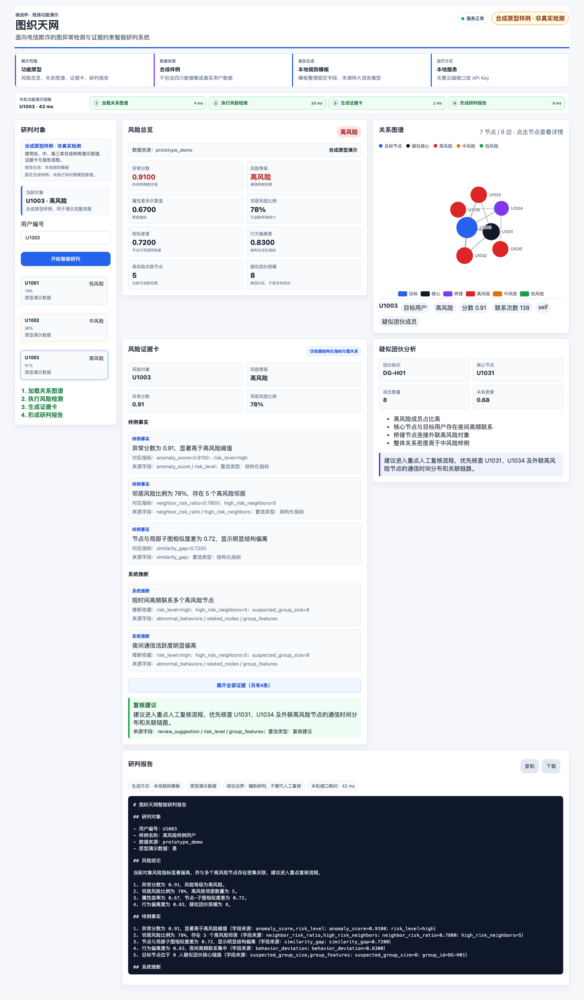

# 图织天网 · 挑战杯现场功能演示

基于现有三栏研判工作台整理的演示前后端：Vue 3 + ECharts + FastAPI。包括样例选择、风险总览、关联图谱、证据卡、报告复制和下载。

**本仓库默认只使用 U1001、U1002、U1003 三个合成原型样例。分数、图关系与行为描述为固定演示内容，报告由本地规则模板整理；不是实时模型检测、真实用户查询或完整 GCLAD 实验。**



## 本地运行

推荐 Python 3.11。源码包附有前端构建产物，可直接启动；无需 API Key、Torch、DGL、数据库或云服务器。

```bash
python3.11 -m venv .venv
source .venv/bin/activate
pip install -r requirements.txt
python run.py
```

Windows 激活命令为 `.venv\Scripts\activate`。打开 http://127.0.0.1:15179 。端口占用可用 `python run.py --port 15180`。Ctrl+C 停止服务。

## 前端开发与重建

Node 24、pnpm 9 或兼容版本：

```bash
cd frontend
pnpm install --frozen-lockfile
pnpm build
```

`pnpm dev` 启动开发页面，其 `/api` 请求代理到本机 15179 端口，需同时运行后端。

前端构建产物忽略在 Git 跟踪之外；从 GitHub 克隆后先构建前端，再在仓库根目录运行 `python run.py`。本应用需要 Python API，直接将源码放到 GitHub Pages 不能运行整个系统。GitHub 用于代码托管；现场演示可用本机服务，避免依赖网络。

## API 与测试

- `GET /api/users`：三个合成样例。
- `GET /api/users/{id}/risk`：固定风险数据及结构化解释。
- `GET /api/users/{id}/graph`：示意图谱。
- `GET /api/users/{id}/evidence-card`：证据字段溯源卡。
- `POST /api/users/{id}/report`：本地规则报告。
- `GET /api/health`：运行状态与非实时推理标识。

```bash
pip install -r requirements-dev.txt
python -m pytest tests -q
```

## 项目结构

- `frontend/src/views/DemoWorkbench.vue`：视频同款三栏工作台的挑战杯副本。
- `backend/main.py`：独立演示 API。
- `model_adapter/`：合成样例加载与数据结构；可作为后续接入自有模型的接口参考。
- `skill/`：规则研判、字段溯源、报告模板。
- `data/demo/`：随包合成样例。

## 现场讲解

先选择 U1001 展示低风险样例的总览和图谱，再选择 U1003 查看结构化证据与报告，最后用 U1002 展示中间状态，演示报告下载。开场说明“本次为合成样例功能演示，算法实验结果另列”，不要把样例分数作为检测准确率。

## 与旧工程的区别

保留原三栏布局和交互，改为挑战杯抬头，移除昇腾训练、其他赛事状态和真实数据切换，报告固定为规则模板。未改写原项目；这是独立副本。旧项目中的四川数据、散列标识、保存预测、模型权重、训练日志、账号配置、密钥及原视频均未纳入此公开仓库。

## 上传 GitHub

将本目录中的源码文件（含 `.gitignore`）上传到仓库根目录，不要只上传 ZIP。`frontend/dist`、依赖目录和本地缓存已加入忽略规则。以 MIT 发布本演示代码，第三方依赖保留各自许可证，见 `THIRD_PARTY_NOTICES.md`。此许可不覆盖未随包发布的导师算法、模型或数据。
